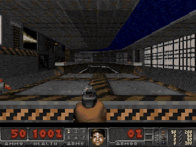
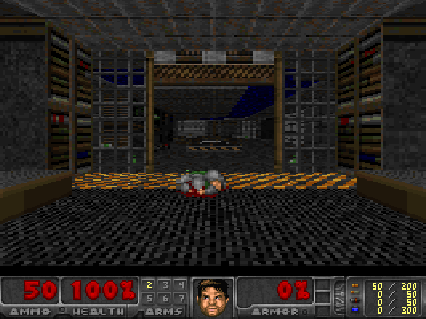

<div align="center">





<sub>Real E1M1 frames from the emulator. The model-verified part is the instruction trace; see below.</sub>

</div>

<div align="center">

# QwenOS

**A tiny operating system that boots, opens a shell, and runs real DOOM, on a CPU that lives inside a language model.**

     

[Quick start](#what-you-can-do-in-30-seconds) · [How it works](#how-it-works-in-one-picture) · [The numbers](#the-numbers) · [What is real](#what-is-real-and-what-is-not) · [The journey](#the-journey) · [The clip](#the-3-second-clip) · [License](#license)

</div>

---

Imagine a computer made of attention layers. That is [Qwenputer](https://github.com/divagr18/qwenputer): a 32-bit RISC-V CPU (RV32IM) compiled into the layers of Qwen3.5, where every instruction is a few generated tokens.
QwenOS is the little OS we gave it: a kernel, a shell, a keyboard, a 32x24 framebuffer and a block disk, all squeezed into **32 KiB of RAM**.
Then we asked it to run a *real* DOOM engine ([DMC100-Doom](https://github.com/ArturBieniek4/DMC100-Doom) on [Freedoom](https://freedoom.github.io) data) as an ordinary program, `/bin/doomd`.
Architecture is inspired by [bobliu-os](https://github.com/Bobliuuu/bobliu-os).

> **Honest summary:** the whole thing works on an emulator. The real Qwen model has verified a cold boot to the first frame marker, and all 45 frames (3 s at 15 fps) of a scripted E1M1 clip, stitched from 35 separately verified chunks. Pixels come from the emulator, not the model. The typed `run /bin/doomd` flow has not been model-verified. Details in [the clip](#the-3-second-clip) and [what is real](#what-is-real-and-what-is-not).

## What you can do in 30 seconds

You need Clang/LLD, `readelf` and Python 3. No game data is in this repo.

```sh
make check                    # kernel, layout, Python reference CPU, unit tests (no WAD needed)
make demo-elf                 # scripted E1M1 image -> build/demo/qwenos-e1m1.elf (+ chunk-ROM plan)
make live-doom                # THE command: fetches engine+Freedoom on first run, boots QwenOS (T0 emulator), shell, then type `doom`
make live-doom LIVE_ARGS=--auto   # same, but it types a shell tour and `run /bin/doomd` for you
# step by step + real-model (T2, GPU) path: docs/LIVE_DEMO.md
```

`demo-elf` and the live terminal need the engine and a WAD, see [get the engine](#get-the-engine-and-freedoom). In the live terminal, arrow keys (or w/s/a/d) move, f or space fires, e uses, and `Ctrl-]` quits.
Other handy targets: `CHUNKROM=1 make demo-live` (typed-flow image) and `tools/doomd_regress.sh` (frame and state goldens).

## How it works in one picture

<p align="center"></p>

Want the picture book? [docs/HOW_IT_WORKS.md](docs/HOW_IT_WORKS.md) has one animation per idea.

## The numbers

All from [`docs/research/STATUS.md`](docs/research/STATUS.md), [`MERGE_NOTES.md`](MERGE_NOTES.md) and the [provenance ledger](docs/research/TRACES/PROVENANCE.md). Instruction counts are guest RV32 instructions.

| Thing | Value |
|---|---|
| RAM | 32 KiB (doomd owns 30,800 B of it while it runs) |
| Exec ROM / data ROM | 256 KiB / 128 KiB, both read-only |
| Chip tokens per instruction | 1.345 (measured on the model boot) |
| Typed flow: boot to prompt | 186 instr |
| Cold boot to first E1M1 frame | 2.9 M to 3.7 M instr, depending on build (2.87 M typed flow, 3.42 M with chunk ROM) |
| Mean instr per game tic, tics 30-300 (FULL preset) | 485,801 with host-served disk, 538,573 with chunk ROM |
| 350 tics of E1M1, total | 180.5 M instr (165,054 disk requests) or 199.7 M with chunk ROM |
| Disk requests with chunk ROM | **4** in total, 0 inside doomd (down from 165,054) |
| Chunk-ROM price | +10.6 % instructions |
| Model speed, A100-SXM4-40GB, end to end | 1,454 chip tokens/s, about 1.1 k instr/s |
| doomd stack headroom | 960 B used of 1,408 B reserved |

FULL preset means a 160x200 low-detail view, game logic every tic, and 15 of every 35 tics drawn. Instructions per tic are means over all tics, skipped draws included.

## What is real and what is not

| Tier | Who ran it | What it has verified |
|---|---|---|
| T0 | C emulator `tools/rv32_fast` | Everything: typed flow, E1M1 gameplay, chunk ROM, regression goldens, a 1060-frame scripted E1M1 video |
| T1 | Upstream reference CPU (`chipformer.rv.ref.Machine`) and our Python reference | Lockstep equal to the emulator for 6,000,000 instr of the merged build (level load and 2 frames); upstream also boots the kernel (120,267 instr) |
| T2 | The real Qwen model (merged Qwen3.5-4B, A100) with a lockstep oracle | Probe; title frame (6,563 instr); **cold boot to the first frame marker: 1,552,382 instr, 292 segments, zero divergence**, on an earlier (pre-merge) build |
| T2, gameplay | The real Qwen model (Qwen3.5-4B, lockstep oracle) | The 3-second E1M1 clip: 45 frames, 35 chunks, 81,065,587 instr, zero divergence, scripted input (see [the clip](#the-3-second-clip)). Not model-verified: the typed `run /bin/doomd` flow (ELF-build level only) |

Things you should know before you get too excited:

- **Disk** is host-served block storage, patched in between model segments. With chunk ROM it is mostly read from the data ROM instead. It is not stored in the weights.
- **Keyboard** input is simulated: the host pushes hardcoded keys through the input mailbox.
- **Clock** is virtual (about 1 ms per idle call), not real time.
- **Pixels** are rendered by the emulator. The model verifies the instruction trace (frame marker, console bytes, instruction count, lockstep), not the pixels.
- **Segments**: a model run is a series of host-snapshotted segments, and "zero divergence" is per segment.
- **Not real-time.** At about 1.1 k instr/s, one game tic (roughly 0.5 to 5 M instr) takes many minutes.
- The typed `run /bin/doomd` flow has not been run on the model; the clip uses a dedicated E1M1 demo build with scripted input. Scope is E1M1.
- Full Python-reference replay covers only segments 1-4; the C twin covers segments 5-38. One chunk (c02) has an unexplained +5 instruction difference that we have not decoded.

Full list: [`docs/research/HONESTY.md`](docs/research/HONESTY.md).

## The 3-second clip

<p align="center"><br><a href="docs/assets/qwenos-doom-3s.mp4">Full-quality MP4 (960x720, 15 fps)</a> · <a href="docs/assets/qwenos-doom-3s-contact.png">contact sheet</a> · <a href="docs/CLIP_LEDGER.md">per-frame and per-chunk ledger</a></p>

E1M1, FULL preset (160x200 low-detail view, status bar), 15 rendered frames per 35 game tics. The player walks forward, turns right, fires the pistol and keeps walking. The input is a compiled-in script (`q_script`), not typed live.

| Field | Value |
|---|---|
| Frames in the clip | 45 (3 s at 15 fps), E1M1 |
| Separate model runs stitched | 35 chunks: 29 Modal A100, 3 Lambda A100, 3 AWS A10G |
| Frames model-verified | 45 of 45 (real Qwen3.5-based model, lockstep oracle, zero divergence) |
| Instructions | 81,065,587 in the run plan; 81,065,591 executed by the model plus 35 host-executed boundary instructions |
| Disk requests | 4 in total (host-served disk replaced by chunk ROM) |

What "verified" means here: the model executed the instruction trace in lockstep with the oracle, and the frame markers and console bytes matched. **The pixels come from the emulator** (same ELF and state), not from the model. Disclosures: keys are simulated, the clock is virtual, the disk is host-served through chunk-ROM windows, and each chunk starts from a host-supplied snapshot. Not covered: the typed `run /bin/doomd` flow; a full Python-reference replay (only segments 1-4, the C twin covers 5-38); and a +5 instruction difference in chunk c02 that we have not decoded. The original run plan failed instruction-count bookkeeping at the c00-c02 split boundary and was reconciled; the ledger links both.

## The journey

<p align="center"></p>

What worked (all in [`docs/research/experiments/`](docs/research/experiments/)):

- A real-WAD BSP viewer on Freedoom, then a DOOM engine port (DMC100) squeezed into 32 KiB.
- A takeover mode where `/bin/doomd` gets all the RAM, and a compact kernel core.
- Instruction diet: perf, syscall squeeze, renderer work, and frame skip (mean cost per tic cut from 10.47 M to 3.52 M instr in the first rounds).
- A live shell with a key ring, so you can type your way into DOOM.
- Chunk ROM: disk reads served from the data ROM (165,054 down to 4 requests).
- Real model runs on an A100: probe, title frame, cold boot.

What did not (see [dead ends](docs/research/experiments/99-dead-ends-and-open-gaps.md)):

- Vanilla doomgeneric: needs hundreds of KB of RAM.
- 1 MiB RAM inside the model, and execute-from-RAM overlays: not possible on this CPU.
- Prefetching, random cache replacement, bigger caches, 80-column "max" preset, serial pixel dump on the model (78 k tokens per frame).

Start with the [research README](docs/research/README.md), then the [timeline](docs/research/TIMELINE.md) and [reproduce](docs/research/REPRODUCE.md). Older per-version notes live in [docs/HISTORY.md](docs/HISTORY.md).

## Get the engine and Freedoom

Neither is included.

```sh
make engine     # = tools/fetch_engine.sh: clone DMC100-Doom @0cdc78e into .deps/, apply the patch, fetch Freedoom 0.13.0, build E1.img
```

`ports/doomdmc/mkimage.sh` builds the NOR disk image (`E1.img`) from the layout and the WAD; `ports/doomdmc/build.sh` builds `doomd`. Override locations with `DMC`, `IWAD`, `QOS_FREEDOOM_WAD`.
The `engine-patches/` diff holds the QwenOS edits to DMC100-Doom (see `engine-patches/NOTICE`).

## Tests

`make check`; `tools/doomd_regress.sh` (state/frame goldens in `tests/golden/`); upstream lockstep needs a checkout of qwenputer on `PYTHONPATH` (see [`MERGE_NOTES.md`](MERGE_NOTES.md)).
`tools/model_doom_qwen.py` and `tools/model_doom_chunks.py` drive the real model and need a GPU box plus the Qwen checkpoint; they are not run in CI.

## License

QwenOS-original code is MIT, see `LICENSE`. The DOOM engine port (`ports/doomdmc/`,
`engine-patches/`, `apps/doomd*`) is built on DMC100-Doom, doomgeneric and DOOM, which are
GPL-2.0, see `COPYING`, so the built `/bin/doomd` image is GPL-2.0. Per-directory breakdown in
`NOTICE`. Freedoom is separate (BSD) and not included.
