<div align="center">


# 🎮 QwenOS

**A tiny operating system that boots, opens a shell, and runs real DOOM, on a CPU that lives inside a language model.** 🧠💾


<sub>🔥 <b>These are real DOOM frames</b>: genuine output of the real DOOM engine (DMC100-Doom + Freedoom) running as RISC-V guest code, not mockups. The engine's RISC-V instructions were executed, and the instruction trace behind each of the 45 frames (81,065,591 instructions in all) was verified instruction by instruction through the real Qwen3.5-4B-based CPU, in lockstep with an oracle. The pixel bytes were read out of the guest's memory, as produced by that code, by the emulator; Qwen verified the trace, it did not decode the pixels. Disclosed plainly: 35 boundary instructions were executed by the host, the input is scripted, the clock is virtual, and each chunk starts from a host snapshot. See <a href="#-what-is-real-and-what-is-not">what is real</a>.</sub>

     

[⚡ Quick start](#-what-you-can-do-in-30-seconds) · [🧩 How it works](#-how-it-works-in-one-picture) · [🐢 How fast?](#-how-fast-is-it-really) · [📊 Numbers](#-the-numbers) · [🔍 What is real](#-what-is-real-and-what-is-not) · [🎬 The clip](#-the-3-second-clip) · [🙋 FAQ](#-faq-for-humans) · [📖 Glossary](#-glossary) · [📜 License](#license)

</div>

---

> ### 🧾 TL;DR
> - 🧠 **What:** a 32-bit RISC-V CPU ([Qwenputer](https://github.com/divagr18/qwenputer)) is built into the layers of Qwen3.5. We wrote a small OS for it and ran the real DOOM engine on top.
> - 🎞️ **Proof:** a 3-second E1M1 clip, 45 frames. Every frame's instruction trace was checked, step by step, by the real model. Zero divergence.
> - 🐌 **Catch:** one displayed frame takes the model about **18 minutes** of GPU time. Real time would be 0.067 seconds. That is a gap of about **16,000x**. The 3-second clip is about **13 hours** of serial GPU time, run in parallel across 35 chunks.
> - 🔍 **Honest bit:** pixels are read from guest memory by the emulator, keys are scripted, the clock is virtual. Details below.
> - 🕹️ **Play it:** on an emulator on your laptop (not on the model). See the [quick start](#-what-you-can-do-in-30-seconds).

---

## 💡 What is this?

Imagine a computer made of attention layers. That is [Qwenputer](https://github.com/divagr18/qwenputer): a 32-bit RISC-V CPU (RV32IM) compiled into the layers of Qwen3.5, where every instruction is a few generated tokens.
QwenOS is the little OS we gave it: a kernel, a shell, a keyboard, a 32x24 framebuffer and a block disk, all squeezed into **32 KiB of RAM** 🤏.
Then we asked it to run a *real* DOOM engine ([DMC100-Doom](https://github.com/ArturBieniek4/DMC100-Doom) on [Freedoom](https://freedoom.github.io) data) as an ordinary program, `/bin/doomd`.
Architecture is inspired by [bobliu-os](https://github.com/Bobliuuu/bobliu-os).

> **Honest summary:** the whole thing works on an emulator. The real Qwen model has verified a cold boot to the first frame marker, and all 45 frames (3 s at 15 fps) of a scripted E1M1 clip, stitched from 35 separately verified chunks. Pixels are read from the guest by the emulator, not decoded by the model. The typed `run /bin/doomd` flow has not been model-verified.

## ⚡ What you can do in 30 seconds

You need Clang/LLD, `readelf` and Python 3. No game data is in this repo.

```sh
make check                    # kernel, layout, Python reference CPU, unit tests (no WAD needed)
make demo-elf                 # scripted E1M1 image -> build/demo/qwenos-e1m1.elf (+ chunk-ROM plan)
tools/qwenos_live.sh --auto   # live terminal demo: boots, types `run /bin/doomd` for you, then it is yours
```

`demo-elf` and the live terminal need the engine and a WAD, see [get the engine](#-get-the-engine-and-freedoom). In the live terminal, arrow keys (or w/s/a/d) move, f or space fires, e uses, and `Ctrl-]` quits.
Other handy targets: `CHUNKROM=1 make demo-live` (typed-flow image) and `tools/doomd_regress.sh` (frame and state goldens).

> 🕹️ A one-command interactive version (`make live-doom`, with a `docs/LIVE_DEMO.md` guide) exists on the branch `feat/live-demo`, not yet merged to main. It runs on the host emulator, not on the model.

## 🧩 How it works in one picture

<p align="center"></p>

Want the picture book? [docs/HOW_IT_WORKS.md](docs/HOW_IT_WORKS.md) has one animation per idea.

## 🐢 How fast is it, really?

Short answer: **very slow, and we are upfront about it.** 😅 Here it is in human units. All of these are *derived from the clip ledger* ([`docs/CLIP_LEDGER.md`](docs/CLIP_LEDGER.md)), not separately measured.

| Question | Plain English | Derivation |
|---|---|---|
| ⏱️ One displayed frame | about **18 minutes** of GPU time | 1.80 M instr per frame / 1,679 instr/s = about 1,072 s |
| 🎲 One game tic | about **5 minutes** of GPU time | 485,801 mean instr per tic (tics 30-300) / 1,679 instr/s = about 290 s |
| 🎞️ The whole 3 s clip, one GPU | about **13 hours** of serial GPU time | 81,065,587 instr / 1,679 instr/s = about 48,300 s (we ran it in parallel across 35 chunks) |
| 🏁 Needed for real time at 15 fps | **0.067 s** per frame | 1 / 15 |
| 📉 The gap | about **16,000x** too slow | 1,072 s / 0.067 s |

<p align="center"></p>

**The derivation, step by step** 🧮

> 📝 **Footnote:** you may see about 28 min per frame if you divide the whole 3 s clip's chunk wall time (76,399 s over 45 frames, see [`docs/CLIP_LEDGER.md`](docs/CLIP_LEDGER.md)) by 45. That number is not representative: it includes the slow early chunks that ran on the original, unpatched driver (672 instr/s, GPU about 15% busy), cold-boot cost, and mixed GPU types. 18 min is the steady-state speed of the patched driver at the 1,679 instr/s median.

1. The clip has 45 frames and the run plan is **81,065,587** guest instructions. 81,065,587 / 45 = **1.80 M instructions per frame**.
2. The model's measured speed (A100) is the median over the 35 chunks: **1,679 instr/s** on the patched driver. The original run was **672 instr/s**.
3. 1.80 M / 1,679 = about 1,072 s, which is about **18 minutes**. At 672 instr/s the same frame would take about 45 minutes.
4. Real time at 15 fps needs a frame every 0.067 s. 1,072 / 0.067 is about **16,000**.

<p align="center"></p>

### 🧪 Speed-up experiments (tonight's work)

> ⚠️ **Host emulator numbers, not Qwen.** These count guest instructions and chip tokens on the host emulator (`rv32_fast`). They say how much less work the model would have to do; none of them has been run on the Qwen model yet. The branches are **not yet merged to main**.

| Experiment | Result (host emulator) | Branch | Status |
|---|---|---|---|
| 🛠️ Compiler: LTO + Zba, hot code `-O3`, cold code `-Os` | **-8.88 %** instructions, **-8.0 %** chip tokens | `perf/compiler` | on branch, not yet merged |
| 🔁 Hot loop: fill magnified wall columns by texel runs | **-7.60 %** instructions, **-11.33 %** chip tokens (on top of the compiler row) | `perf/hotloops` | on branch, not yet merged |
| ➕ Cumulative (both rows) | **-15.8 %** instructions, **-18.4 %** chip tokens vs the original | `perf/hotloops` | on branch, not yet merged |
| 🧹 Sim: `memcpy`/`memset` and `FixedDiv` fast paths (exact, same output) | **-1.12 %** instructions, **-1.03 %** chip tokens | `perf/sim` | on branch, not yet merged |
| 🎚️ Visual presets `fast` / `lite` | **-40 %** / **-12 %** (at 15 fps) | `perf/presets` | on branch, not yet merged. A **visual tradeoff**, the picture looks worse |
| 🔬 Basic-block trace: where the work is | hottest block `R_ColumnLoop` is 18.1 % of instructions; the top 100 blocks cover 65.7 %. Fusing blocks into the weights would save only **2-5 %** of tokens and needs a circuit rebuild, so we are not doing it | `perf/bbtrace` | on branch, not yet merged |
| 🧾 Old vs combined **model** benchmark | <!-- PENDING:model-benchmark --> pending | | pending |

### 🖥️ Measured on the real model (Modal)

> These rows were **measured on the real model, on Modal GPUs**, not on the host emulator.

**E1: how fast can one token go?** Microseconds per chip token (lower is better), on the real model. Columns: graph only / with the host loop / K=16 tokens per graph.

| GPU | graph only | host loop | K=16 per graph |
|---|---|---|---|
| A100 | 242 | 283 | 242 |
| A10G | 319 | 372 | 319 |
| L4 | 193 | 239 | 193 |
| L40S | 165 | 186 | 167 |
| H100 | 203 | 225 | 205 |
| B200 | could not be scheduled on Modal, $0 spent, unavailable | | |

The GPU kernels (36 per token: attention head 50 %, FFN 32 %, apply 15 %) are the floor. Faster GPUs barely help: an H100 is only 1.19x an A100. The host loop adds about 15 % on top, and K=16 per graph removes it. Branch status: measurement only, no code change to merge.

**E3: verify K tokens in bulk (A100, one chunk, c34, 1.58 M chip tokens).** Every token is still compared to the oracle, with zero lockstep errors.

| K | instr/s | chunk time | speed-up |
|---|---|---|---|
| 0 (baseline) | 1,546 | 705.6 s | 1.00x |
| 16 | 2,275 | 479 s | 1.47x |
| 64 | 2,353 | 464 s | 1.52x |
| 256 | 2,375 | 459 s | 1.54x |

Branch `perf/ktoken`, not yet merged.

**E4: fixed costs.** A text token costs 45 ms warm, plus 0.21 s fixed per segment.

**Why 18 minutes will not become 18 seconds:** with the GPU kernel floor (about 240 us per token on A100), only the host overhead can be trimmed. The final old-vs-combined benchmark is the pending row above.

<p align="center"></p>

## 📊 The numbers

All from [`docs/research/STATUS.md`](docs/research/STATUS.md), [`MERGE_NOTES.md`](MERGE_NOTES.md) and the [provenance ledger](docs/research/TRACES/PROVENANCE.md). Instruction counts are guest RV32 instructions. "Plain English" is our conversion, using the median 1,679 instr/s where a time is given.

| Thing | Value | Plain English |
|---|---|---|
| 🧠 RAM | 32 KiB (doomd owns 30,800 B while it runs) | 0.03 MiB |
| 📀 Exec ROM / data ROM | 256 KiB / 128 KiB, both read-only | |
| 🔤 Chip tokens per instruction | 1.345 (measured on the model boot) | |
| ⌨️ Typed flow: boot to prompt | 186 instr | about a tenth of a second at 1,679 instr/s |
| 🥾 Cold boot to first E1M1 frame | 2.9 M to 3.7 M instr, depending on build | roughly 30 to 40 minutes at 1,679 instr/s |
| 🎲 Mean instr per game tic, tics 30-300 (FULL preset) | 485,801 with host-served disk, 538,573 with chunk ROM | about 5 minutes per tic |
| 🕐 350 tics of E1M1, total | 180.5 M instr (165,054 disk requests) or 199.7 M with chunk ROM | about 30 hours on one GPU |
| 💽 Disk requests with chunk ROM | **4** in total, 0 inside doomd (down from 165,054) | |
| 📦 Chunk-ROM price | +10.6 % instructions | |
| 🚀 Model speed, A100-SXM4-40GB, end to end (boot run) | 1,454 chip tokens/s, about 1.1 k instr/s | |
| 📚 doomd stack headroom | 960 B used of 1,408 B reserved | |

FULL preset means a 160x200 low-detail view, game logic every tic, and 15 of every 35 tics drawn. Instructions per tic are means over all tics, skipped draws included.

## 🔍 What is real and what is not

<p align="center"></p>

| Tier | Who ran it | What it has verified |
|---|---|---|
| 🟦 T0 | C emulator `tools/rv32_fast` | Everything: typed flow, E1M1 gameplay, chunk ROM, regression goldens, a 1060-frame scripted E1M1 video |
| 🟨 T1 | Upstream reference CPU (`chipformer.rv.ref.Machine`) and our Python reference | Lockstep equal to the emulator for 6,000,000 instr of the merged build (level load and 2 frames); upstream also boots the kernel (120,267 instr) |
| 🟩 T2 | The real Qwen model (merged Qwen3.5-4B, A100) with a lockstep oracle | Probe; title frame (6,563 instr); **cold boot to the first frame marker: 1,552,382 instr, 292 segments, zero divergence**, on an earlier (pre-merge) build |
| 🟩 T2, gameplay | The real Qwen model (Qwen3.5-4B, lockstep oracle) | The 3-second E1M1 clip: 45 frames, 35 chunks, 81,065,587 instr, zero divergence, scripted input (see [the clip](#-the-3-second-clip)). Not model-verified: the typed `run /bin/doomd` flow (ELF-build level only) |

Things you should know before you get too excited 🧯:

- 💽 **Disk** is host-served block storage, patched in between model segments. With chunk ROM it is mostly read from the data ROM instead. It is not stored in the weights.
- ⌨️ **Keyboard** input is simulated: the host pushes hardcoded keys through the input mailbox.
- 🕰️ **Clock** is virtual (about 1 ms per idle call), not real time.
- 🖼️ **Pixels**: the frames are genuine DOOM output, but the pixel bytes are read from the guest's memory by the emulator (same ELF and state). The model verifies the instruction trace (frame marker, console bytes, instruction count, lockstep), not the pixels.
- 🧩 **Segments**: a model run is a series of host-snapshotted segments, and "zero divergence" is per segment.
- 🐌 **Not real-time.** See [how fast is it](#-how-fast-is-it-really).
- The typed `run /bin/doomd` flow has not been run on the model; the clip uses a dedicated E1M1 demo build with scripted input. Scope is E1M1.
- Full Python-reference replay covers only segments 1-4; the C twin covers segments 5-38. One chunk (c02) has an unexplained +5 instruction difference that we have not decoded.

Full list: [`docs/research/HONESTY.md`](docs/research/HONESTY.md).

## 🎬 The 3-second clip

<p align="center"><br><a href="docs/assets/qwenos-doom-3s.mp4">Full-quality MP4 (960x720, 15 fps)</a> · <a href="docs/assets/qwenos-doom-3s-contact.png">contact sheet</a> · <a href="docs/CLIP_LEDGER.md">per-frame and per-chunk ledger</a></p>

E1M1, FULL preset (160x200 low-detail view, status bar), 15 rendered frames per 35 game tics. The player walks forward, turns right, fires the pistol and keeps walking. The input is a compiled-in script (`q_script`), not typed live.

| Field | Value |
|---|---|
| 🎞️ Frames in the clip | 45 (3 s at 15 fps), E1M1 |
| 🧱 Separate model runs stitched | 35 chunks: 29 Modal A100, 3 Lambda A100, 3 AWS A10G |
| ✅ Frames with a model-verified instruction trace | 45 of 45 (real Qwen3.5-based model, lockstep oracle, zero divergence) |
| 🔢 Instructions | 81,065,587 in the run plan; 81,065,591 executed by the model plus 35 host-executed boundary instructions |
| 💽 Disk requests | 4 in total (host-served disk replaced by chunk ROM) |

What "verified" means here: the model executed the instruction trace in lockstep with the oracle, and the frame markers and console bytes matched. **The frames are real output of the real DOOM engine**; the pixel bytes are read from the guest's memory by the emulator (same ELF and state), so Qwen verified the computation that made them, not the pixel values themselves. Disclosures: keys are simulated, the clock is virtual, the disk is host-served through chunk-ROM windows, 35 boundary instructions are host-executed, and each chunk starts from a host-supplied snapshot. Not covered: the typed `run /bin/doomd` flow; a full Python-reference replay (only segments 1-4, the C twin covers 5-38); and a +5 instruction difference in chunk c02 that we have not decoded. The original run plan failed instruction-count bookkeeping at the c00-c02 split boundary and was reconciled; the ledger links both.

## 🙋 FAQ for humans

<details>
<summary><b>🤔 What is this, in one sentence?</b></summary>

A real DOOM engine running on a tiny OS, on a CPU whose every instruction is carried out by a language model generating tokens. A computer made of attention layers, playing DOOM, very slowly.
</details>

<details>
<summary><b>🐌 Why is it so slow?</b></summary>

Every guest instruction costs about 1.345 generated tokens, and the model produces tokens one after another. One DOOM frame is about 1.8 million instructions, so the GPU does millions of tiny sequential steps per frame. At the median 1,679 instr/s that is about 18 minutes. A normal CPU does the same work in a fraction of a millisecond.

Where do the instructions go? Mostly into drawing. Tics that draw a frame cost 1.1 to 2.2 M instructions, while a tic with no draw costs only about 16 to 37 k, so the median over all tics (about 138 k) looks small. Over the whole run, game logic is about 6 % and rendering about 94 %.
</details>

<details>
<summary><b>🧠 Is it really Qwen?</b></summary>

Yes for the instruction trace: the model (merged Qwen3.5-4B carrying the Qwenputer circuit) executed 81,065,591 instructions of the clip with a lockstep oracle and zero divergence. The host executed 35 boundary instructions, serves disk, injects scripted keys, and starts each chunk from a snapshot. Qwen did not decode the pixels. See [what is real](#-what-is-real-and-what-is-not).
</details>

<details>
<summary><b>🕹️ Can I play it?</b></summary>

Yes, on the host emulator (T0): `tools/qwenos_live.sh` gives an interactive terminal with arrows to move. Playing it on the model is not practical: one tic takes about 5 minutes. A one-command version, `make live-doom`, is on the branch `feat/live-demo` (not yet merged).
</details>

<details>
<summary><b>🏎️ Why not just make it faster?</b></summary>

We are trying; see the [speed-up experiments](#-speed-up-experiments-tonights-work). The compiler and hot-loop work cut about 16 % of instructions on the host emulator. Even a 40 % cut would still leave a gap of thousands of times. The model speed (tokens per second) is the real wall, and instruction fusion inside the weights would save only 2-5 % of tokens.
</details>

<details>
<summary><b>🖼️ Are the frames real?</b></summary>

Yes. They are the genuine output of the real DOOM engine running as guest code, not mockups. See the caption at the top and the [clip ledger](docs/CLIP_LEDGER.md) for every frame and chunk.
</details>

## 📖 Glossary

| Term | Meaning |
|---|---|
| 🎲 **tic** | One step of DOOM's game logic. DOOM runs 35 tics per second. |
| 🖼️ **frame** | One picture we actually draw. The clip draws 15 frames for every 35 tics (about 15 fps). |
| 🧱 **chunk** | One separate model run covering a slice of the trace. The clip is 35 chunks stitched together, each started from a host snapshot. |
| 🔒 **lockstep** | The model executes each instruction while an oracle (a trusted reference) executes the same one. Any mismatch is a divergence. We saw zero. |
| 🔤 **chip token** | A token the model generates as part of executing one guest instruction. About 1.345 per instruction. |
| 🟦🟨🟩 **T0 / T1 / T2** | Who ran the code. T0: the C emulator. T1: reference CPUs (upstream and Python), checked against T0. T2: the real Qwen model with a lockstep oracle. |
| 🧩 **segment** | A stretch of a model run between host interventions such as disk service. |
| 📀 **chunk ROM** | Game data served from a read-only ROM window, which cut disk requests from 165,054 to 4. |

## 🗺️ The journey

<p align="center"></p>

What worked ✅ (all in [`docs/research/experiments/`](docs/research/experiments/)):

- A real-WAD BSP viewer on Freedoom, then a DOOM engine port (DMC100) squeezed into 32 KiB.
- A takeover mode where `/bin/doomd` gets all the RAM, and a compact kernel core.
- Instruction diet: perf, syscall squeeze, renderer work, and frame skip (mean cost per tic cut from 10.47 M to 3.52 M instr in the first rounds).
- A live shell with a key ring, so you can type your way into DOOM.
- Chunk ROM: disk reads served from the data ROM (165,054 down to 4 requests).
- Real model runs on an A100: probe, title frame, cold boot.

What did not ❌ (see [dead ends](docs/research/experiments/99-dead-ends-and-open-gaps.md)):

- Vanilla doomgeneric: needs hundreds of KB of RAM.
- 1 MiB RAM inside the model, and execute-from-RAM overlays: not possible on this CPU.
- Prefetching, random cache replacement, bigger caches, 80-column "max" preset, serial pixel dump on the model (78 k tokens per frame).

Start with the [research README](docs/research/README.md), then the [timeline](docs/research/TIMELINE.md) and [reproduce](docs/research/REPRODUCE.md). Older per-version notes live in [docs/HISTORY.md](docs/HISTORY.md).

## 📦 Get the engine and Freedoom

Neither is included.

```sh
mkdir -p ../engine ../wads
git clone https://github.com/ArturBieniek4/DMC100-Doom ../engine/DMC100-Doom
(cd ../engine/DMC100-Doom && git checkout 0cdc78e && patch -p1 < "$OLDPWD/engine-patches/dmc100-qwenos-merged.patch")
# Freedoom (modified BSD): https://freedoom.github.io  -> unzip freedoom1.wad into ../wads/
```

`ports/doomdmc/mkimage.sh` builds the NOR disk image (`E1.img`) from the layout and the WAD; `ports/doomdmc/build.sh` builds `doomd`. Override locations with `DMC`, `IWAD`, `QOS_FREEDOOM_WAD`.
The `engine-patches/` diff holds the QwenOS edits to DMC100-Doom (see `engine-patches/NOTICE`).

## 🧪 Tests

`make check`; `tools/doomd_regress.sh` (state/frame goldens in `tests/golden/`); upstream lockstep needs a checkout of qwenputer on `PYTHONPATH` (see [`MERGE_NOTES.md`](MERGE_NOTES.md)).
`tools/model_doom_qwen.py` and `tools/model_doom_chunks.py` drive the real model and need a GPU box plus the Qwen checkpoint; they are not run in CI.

## License

QwenOS-original code is MIT, see `LICENSE`. The DOOM engine port (`ports/doomdmc/`,
`engine-patches/`, `apps/doomd*`) is built on DMC100-Doom, doomgeneric and DOOM, which are
GPL-2.0, see `COPYING`, so the built `/bin/doomd` image is GPL-2.0. Per-directory breakdown in
`NOTICE`. Freedoom is separate (BSD) and not included.
