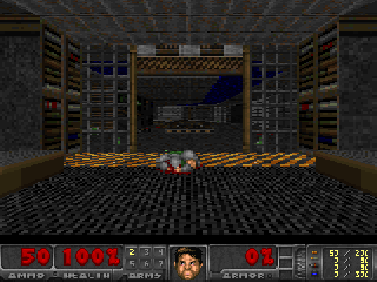

# How QwenOS runs DOOM (the picture book)

Look, don't read. Every picture moves. This is the story now: the model emits the pixels itself, the typed flow is model-verified, and it runs about 2x faster. (The first 3 s clip is the little section at the end.) For the headline numbers see the [README](../README.md); for the evidence see [research](research/README.md).

 

*This GIF is the first clip. Real DOOM frames: genuine output of the real DOOM engine running as RISC-V guest code. In that clip the model verified the instruction trace of every frame in lockstep and the emulator read the pixel bytes out of guest memory. Now the model emits them (see section 1b and the progress line in the [README](../README.md)).*

## 1. The stack

A keystroke dives six layers down. A frame climbs back up.

The host is a very dumb helper: it pushes key bytes and serves disk blocks. It never runs game logic.

## 1b. Where the pixels come from

The engine draws a frame, a guest dump routine writes about 32,100 console bytes (rows 0-199, not the status bar), the Qwen chip emits each one as a **BYTE token**, the lockstep oracle checks every token, and the host only collects bytes into a PNG. The README's progress line says how many frames are done.

## 2. One frame, token by token

About 0.49 M instructions per game tic, 1.345 chip tokens each.

Boot to the `$ ` prompt is 184 instructions (186 in the merged build). Typing `run /bin/doomd` costs about 1,050.

## 3. The 32 KiB map

doomd **takes over** nearly all the RAM. The code lives in read-only ROM, because this CPU cannot execute from RAM.

## 4. Lockstep: every token must match

What has actually run on the model: a probe, a title frame (6,563 instr), and a cold boot to the first frame marker (1,552,382 instr, 292 segments, zero divergence, earlier pre-merge build). Since then the model has also verified a 45-frame (3 s) scripted E1M1 clip: 35 chunks, 81,065,587 instructions, zero divergence, with pixels rendered by the emulator ([ledger](CLIP_LEDGER.md)).

## 5. Why chunk ROM removes the disk pauses

`tools/chunkrom.py` plans which disk bytes each stretch of the game needs and preloads them into the window at 0x29000..0x3f000. If a read misses, the engine still falls back to the disk mailbox, so correctness never depends on the plan (a deliberate-miss test gives byte-identical output). Price: +10.6 % instructions.

## 6. Chunking across GPUs

The clip was split into 35 chunks and run on 29 Modal A100, 3 Lambda A100 and 3 AWS A10G jobs, each verified in lockstep. The diagram shows the idea; the real ledger is [CLIP_LEDGER.md](CLIP_LEDGER.md).

## 7. The journey

## Honesty box

> **Now:** the model emits the pixel bytes of the frames counted in the README progress line (each byte lockstep-checked, byte-exact vs the emulator), and the typed `boot -> shell -> help/ls -> run /bin/doomd -> first frame` flow is model-verified (3 Modal A100 chunks, 3,335,072 instr, 26 segments, zero divergence). Disk is host-served, keys are scripted or come through the key ring, the clock is virtual, and it is not real time. Status-bar rows 208-239 are not in a frame's dump. The tuned build has not been re-verified over the whole clip. Full list: [HONESTY.md](research/HONESTY.md).

## What changed since the first clip, in five lines

- Before: every instruction of the 3 s clip was verified, but the emulator read the pixels out of memory.
- Before: the typed flow was not run on the model.
- Now: the model emits the pixels; the typed flow is verified.
- Now: about 2x faster on the model (block verification plus fused kernels, bit-exact), and a tuned build that runs fewer instructions.
- Still true: not real time. One frame is projected at about 8 to 10 minutes of A100 time (before: about 18).

## Where to go next

- [MERGE_NOTES.md](../MERGE_NOTES.md): addresses, numbers, known gaps of the final build.
- [docs/research/](research/README.md): TL;DR, status, honesty list, every experiment.
- [HISTORY.md](HISTORY.md): older per-version notes.
