# How QwenOS runs DOOM (the picture book)

Look, don't read. Every picture moves. For the headline numbers see the [README](../README.md); for the evidence see [research](research/README.md).

 

*Real E1M1 frames from the emulator (the C emulator renders the pixels; see the honesty box below).*

## 1. The stack

A keystroke dives six layers down. A frame climbs back up.

The host is a very dumb helper: it pushes key bytes and serves disk blocks. It never runs game logic.

## 2. One frame, token by token

About 0.49 M instructions per game tic, 1.345 chip tokens each.

Boot to the `$ ` prompt is 184 instructions (186 in the merged build). Typing `run /bin/doomd` costs about 1,050.

## 3. The 32 KiB map

doomd **takes over** nearly all the RAM. The code lives in read-only ROM, because this CPU cannot execute from RAM.

## 4. Lockstep: every token must match

What has actually run on the model: a probe, a title frame (6,563 instr), and a cold boot to the first frame marker (1,552,382 instr, 292 segments, zero divergence, earlier pre-merge build). Gameplay frames are 🚧 in progress <!-- PENDING:clip -->.

## 5. Why chunk ROM removes the disk pauses

`tools/chunkrom.py` plans which disk bytes each stretch of the game needs and preloads them into the window at 0x29000..0x3f000. If a read misses, the engine still falls back to the disk mailbox, so correctness never depends on the plan (a deliberate-miss test gives byte-identical output). Price: +10.6 % instructions.

## 6. Next up: chunking across GPUs

🚧 A plan, not a result. <!-- PENDING:clip -->

## 7. The journey

## Honesty box

> The pixels in the GIF come from the emulator. The model verifies the instruction trace (frame marker, console bytes, instruction count, lockstep), not the pixels. Disk is host-served, keyboard input is simulated, the clock is virtual, and it is not real time (about 1.1 k instr/s). The 3-second clip and gameplay frames on the model are in progress. Full list: [HONESTY.md](research/HONESTY.md).

## Where to go next

- [MERGE_NOTES.md](../MERGE_NOTES.md): addresses, numbers, known gaps of the final build.
- [docs/research/](research/README.md): TL;DR, status, honesty list, every experiment.
- [HISTORY.md](HISTORY.md): older per-version notes.
