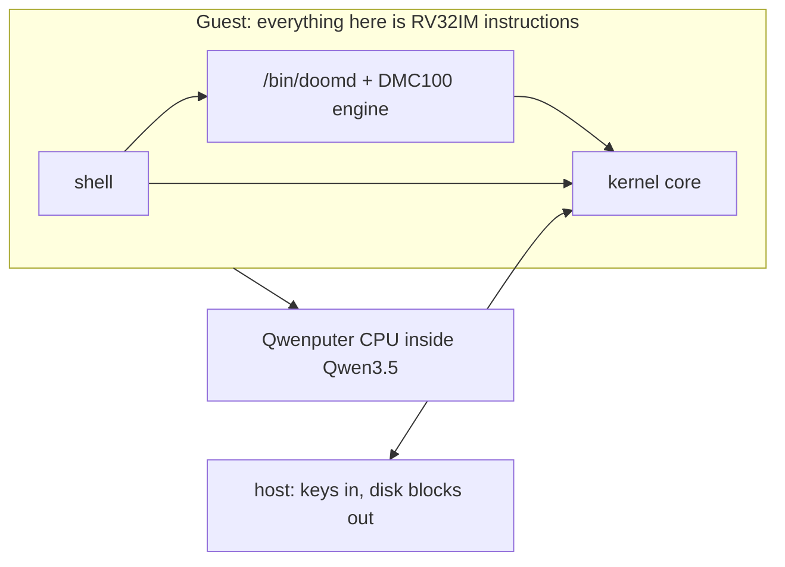
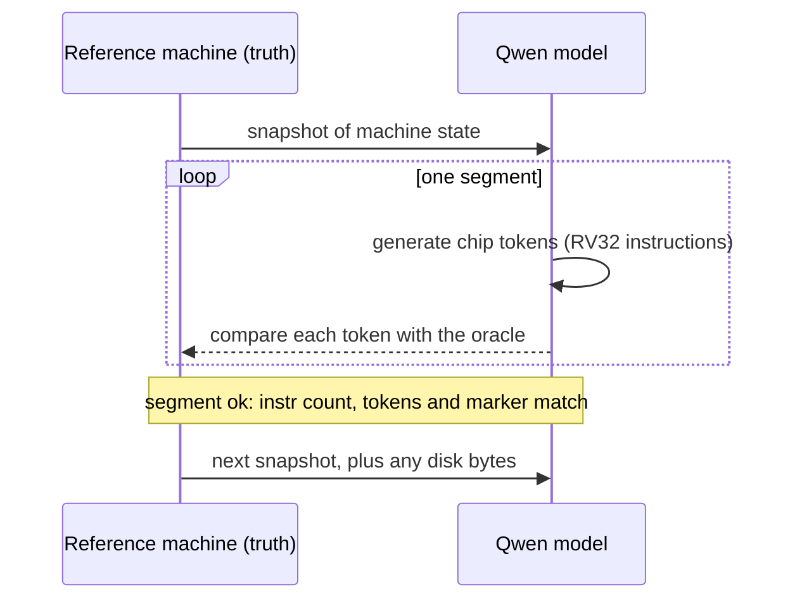
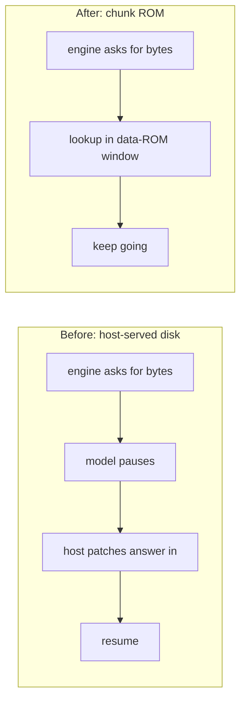

# How QwenOS runs DOOM, step by step

A gentle tour. No assembly required. For the headline numbers see the [README](../README.md); for the evidence see [research](research/README.md).

## The cast



The guest is a normal little OS. The host is a very dumb helper that pushes key bytes and serves disk blocks. It never runs game logic.

## Step 1: boot

The CPU resets and the kernel runs. In the live build it prints `$ ` and parks, waiting for a key. That takes **184 instructions** after reset (186 in the merged build). There is no banner, because every instruction is precious when each one costs a couple of tokens.

## Step 2: the shell

You type `run /bin/doomd` and press Enter. The shell echoes each key (about 70 instructions per key), and understands `ls`, `cat`, `echo`, `run /bin/X` and `exit`. Typing the whole command costs about 1,050 instructions.

## Step 3: takeover

`doomd` is special. A normal app shares RAM with the kernel; `doomd` **takes over** nearly all of it.

```text
RAM 0x0000 .. 0x7fff  (32 KiB)
+----------------+ 0x0000
| null guard     |  stays zero forever
+----------------+ 0x0100
| kernel core    |  keys, disk mailbox, 32x24 framebuffer (0x154, 0x15c, 0x270)
+----------------+ 0x0570
| doomd          |  30,800 B: data, frame region, stack growing down
+----------------+ 0x8000
```

The kernel zeroes the RAM above its core, then hands it over. The code itself lives in read-only ROM (256 KiB exec, 128 KiB data), because this CPU cannot execute from RAM.

## Step 4: one frame

Each game tic the engine reads keys from the 4-deep key ring, moves the world, and, on the tics it chooses to draw, renders the view straight into the framebuffer. Then it prints a frame marker on the console. In the FULL preset it draws 15 of every 35 tics (game logic still runs every tic). Reading map and texture data goes through the disk.

## Step 5: how the model checks it in lockstep

The model does not "see" the game. It **executes the CPU**, token by token, and a reference machine checks every step.



A run is a chain of **segments**. Each starts from a host snapshot, and "zero divergence" means every chip token matched the oracle inside that segment. The pixels you would see in a video come from the emulator rendering the same state; the model vouches for the instruction trace (frame marker, console bytes, instruction count), not the pixels.

What has actually happened on the model: a probe, a title frame (6,563 instr), and a cold boot to the first frame marker (1,552,382 instr, 292 segments, zero divergence). Gameplay frames are 🚧 in progress <!-- PENDING:clip -->.

## Step 6: why chunk ROM removes the disk pauses

The disk is the awkward part. Every disk request means the model must **pause**, the host must patch the answer into the machine state, and the model resumes. Without help, 350 tics of E1M1 make **165,054** requests, each one a segment boundary.



The idea: the data ROM has 128 KiB of read-only space. A planner (`tools/chunkrom.py`) looks at which disk bytes each stretch of the game will need and preloads them into a window at 0x29000..0x3f000. The plan has 5 chunks, switching at frame markers 0, 4, 17, 31, 100 and 152. If a read misses the window the engine still falls back to the disk mailbox, so correctness never depends on the plan (a deliberate-miss test gives byte-identical output).

Result: **4 disk requests in total** (all tiny reads at boot), for about +10.6 % instructions.

## Where to go next

- [MERGE_NOTES.md](../MERGE_NOTES.md): addresses, numbers, known gaps of the final build.
- [docs/research/](research/README.md): TL;DR, status, honesty list, every experiment.
- [HISTORY.md](HISTORY.md): older per-version notes.
